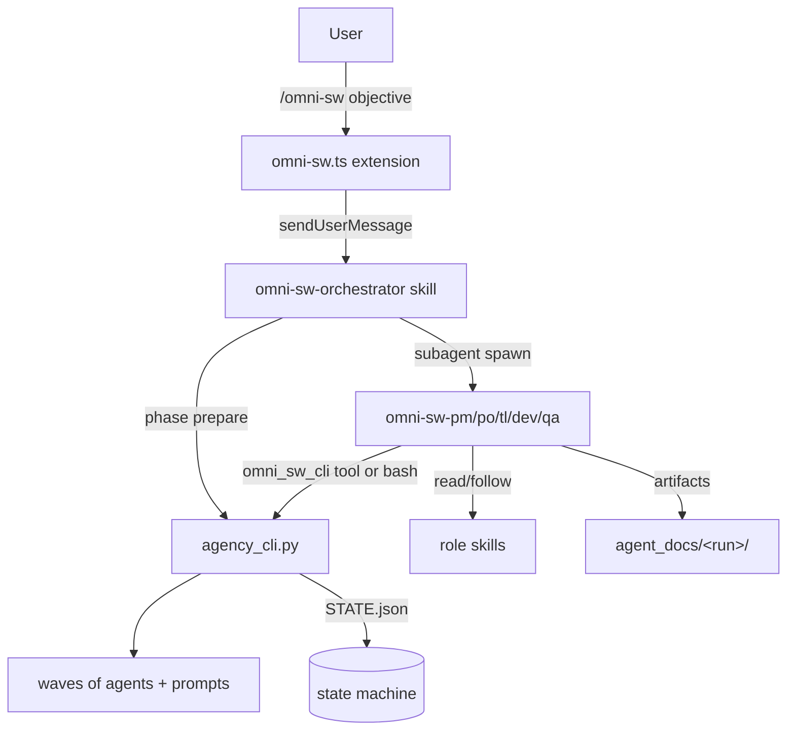

# Architecture

## Package layout

```text
pi-omni-sw/
├── package.json              # pi manifest: extensions, skills, subagents.agents
├── tsconfig.json
├── extensions/
│   └── omni-sw.ts            # command + tool + path manifest + python detection
├── skills/                   # discovered via pi.skills
│   ├── omni-sw-orchestrator/ # the flow
│   ├── omni-sw-{pm,po,tl,dev,qa}/
│   ├── omni-sw-backlog/      # + scripts/backlog_manager.py
│   ├── omni-sw-{init-omni-sw,repo-map,project-map,apply-progressive-disclosure,skill-creator,api-doc-scraper}/
│   └── omni-sw-shared/       # agent-common.md, templates/, models.json, scripts/agency_cli.py
└── agents/                   # discovered via pi.subagents.agents
    └── omni-sw-{pm,po,tl,dev,qa}.md
```

## How the pieces fit



- **Extension** (`extensions/omni-sw.ts`) is the pi-native entry point. It registers the `/omni-sw` command and the `omni_sw_cli` tool, detects Python, and writes `~/.pi/agent/omni-sw.json`.
- **Orchestrator skill** holds the workflow logic and spawns agents via pi-subagents.
- **Role agents** are thin: they read their role skill and do the work.
- **Agency CLI** is the deterministic core: phase sequencing, gate parsing, backlog batch operations, state, metrics, pipelines.

## Path resolution

Skills must find the CLI whether installed as a pi package or copied into `~/.pi/agent/skills`. Resolution order (first match wins):

1. `$OMNI_SW_CLI` — set by the extension during CLI invocation env.
2. `~/.pi/agent/omni-sw.json` → `cli` — written by the extension at load and on `session_start`.
3. Glob `**/omni-sw-shared/scripts/agency_cli.py` — standalone skill installs.

The same manifest also exposes `backlog_script` and `models`.

## Deterministic core

`agency_cli.py` exposes 16 command groups. The most important for the flow:

| Group | Responsibility |
| ------- | ---------------- |
| `init` / `setup` | Resolve project paths, create dirs, validate environment |
| `phase` | `sequence`, `next`, `prepare` (state + agent order + prompts in one call) |
| `gate` | Parse verdict markers from phase artifacts |
| `agent` | Model lookup, naming, prompt generation, wave ordering |
| `state` | Persistent state machine + gate records + checkpoints |
| `backlog` | Batch transitions and validation against permissions |
| `pipeline` | Feature-parallel execution grouping |
| `metrics` / `report` | Observability and summaries |
| `notify` / `decision` | OS notifications and append-only decision log |

Keeping this logic in Python (instead of in prompts) is what makes the workflow cheap and reproducible.

## Model routing

`skills/omni-sw-shared/models.json` maps abstract tiers to concrete pi model ids:

```json
{ "opus": null, "sonnet": null, "haiku": null }
```

- A `null` tier → the orchestrator omits the `model` override; the agent inherits the session default.
- A string tier → passed as the `model` parameter to `subagent({...})`.

## State and recovery

- `agent_docs/agency/STATE.json` tracks phase status, gate verdicts and iterations.
- `agent_docs/agency/CHECKPOINT.md` is a compact progress summary written after each phase.
- After context compaction, the orchestrator re-reads the checkpoint and `state query` instead of relying on conversation history.

## Agent execution model

Each phase defines ordered **waves**. The orchestrator spawns a wave in parallel, waits for it, then spawns the next. Leads run first; assists that depend on a lead's artifact run later.

Agents are spawned with a registered pi-subagents id (`omni-sw-pm`, …) and a fully-resolved prompt containing every path they need (`PROJECT_ROOT`, `SCRIPT_PATH`, `BACKLOG_PATH`, `CLI_PATH`, `STATE_PATH`, `DOCS_PATH`, `AGENT_COMMON`, `SKILL_PATH`). Agents never re-resolve paths via Glob.

## Compatibility notes

- Claude Code notification hooks are **opt-in** (`OMNI_SW_CLAUDE_HOOKS=1`); pi does not use them.
- Backlog permissions are enforced by `backlog_manager.py` via `--caller <role>`.
