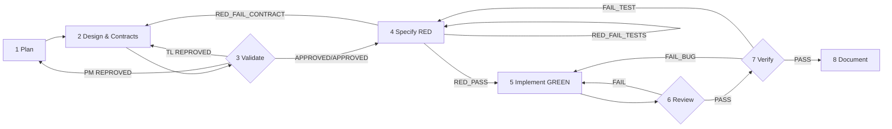
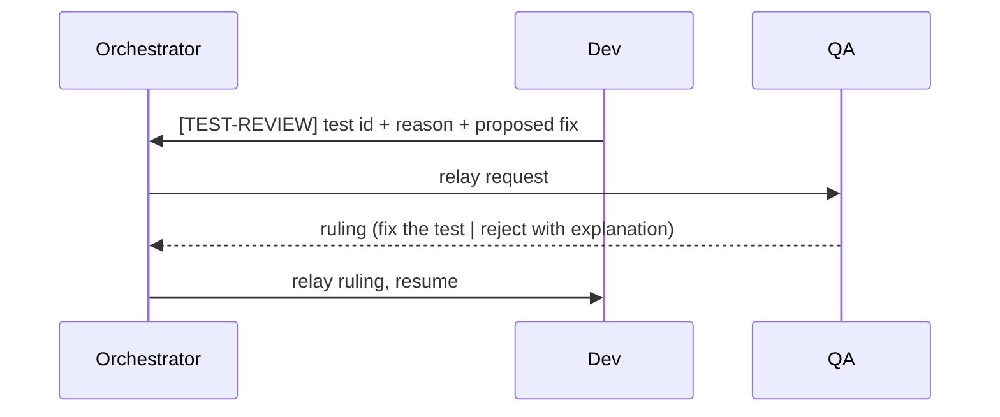

# The TDD flow

`pi-omni-sw` runs eight phases. The defining property is that the test suite is authored **before** the implementation and derived from explicit contracts.

## Phases at a glance

| # | Phase | Leads | Assists | Artifacts |
| --- | ------- | ------- | --------- | ----------- |
| 1 | Plan | PM → PO | TL, Dev, QA | `PROJECT_BRIEF.md`, backlog |
| 2 | Design & Contracts | TL | Dev, QA | `ARCHITECTURE.md`, `CONTRACTS.md` |
| 3 | Validate (gate) | PM + TL | PO | `VALIDATION.md` |
| 4 | Specify (RED, gate) | QA | TL | `TEST_SPEC.md`, failing tests |
| 5 | Implement (GREEN) | Dev | TL | `src/`, complementary tests |
| 6 | Review (gate) | TL | QA | `REVIEW.md` |
| 7 | Verify (gate) | QA | TL | `TEST_REPORT.md` |
| 8 | Document | PM + TL | PO, Dev, QA | `README.md`, `CHANGELOG.md`, `API_REFERENCE.md` |

## 1. Plan

PM elicits business objectives and writes `PROJECT_BRIEF.md`; PO turns it into a backlog whose **acceptance criteria are verifiable** — QA will transform each one into a test. TL/Dev/QA assists add risk, implementability and testability notes.

## 2. Design & Contracts

TL produces two mandatory artifacts:

- `ARCHITECTURE.md` — system overview (Mermaid), stack, data models, component architecture, error handling, security.
- `CONTRACTS.md` — the normative anchor for tests: API endpoints (methods, paths, schemas, status codes), interface/port signatures with invariants and pre/post-conditions, data models and validations, event/message contracts, and the error taxonomy.

It must be complete enough that QA can author the whole suite **without guessing**.

## 3. Validate (dual gate)

PM (business) and TL (technical, including contract completeness) evaluate in parallel.

| PM | TL | Result |
| ---- | ---- | -------- |
| APPROVED | APPROVED | proceed to Specify |
| REPROVED | any | back to Plan |
| any | REPROVED | back to Design |

## 4. Specify — RED (strict gate)

QA derives the suite mechanically:

- one acceptance test per `Must` acceptance criterion;
- one contract test per element of `CONTRACTS.md`;
- boundary/edge cases implied by the criteria.

QA writes `TEST_SPEC.md` with an AC↔test traceability matrix and ends with a verdict:

| Verdict | Meaning | Next |
| --------- | --------- | ------ |
| `RED_PASS` | complete, compiles, all tests fail for the right reason, no implementation yet | Implement |
| `RED_FAIL_TESTS` | missing tests, passing tests, or infra errors | re-run Specify |
| `RED_FAIL_CONTRACT` | contracts missing/ambiguous/untestable | back to Design |

## 5. Implement — GREEN

Dev makes the frozen suite pass, following `ARCHITECTURE.md` and `CONTRACTS.md`. Dev may add **distinctly named** complementary tests (`*_dev_complement.*`) but must never edit, delete or weaken a QA-authored test.

## 6. Review (gate)

TL reviews for architecture compliance, quality, security, error handling, conventions, and **test integrity** — no empty assertions, no over-mocking that bypasses real behaviour, no weakened tests. `PASS` proceeds; `FAIL` returns to Implement.

## 7. Verify (gate)

QA re-runs the frozen suite in a clean environment and checks AC traceability, contract coverage, integration/e2e and regression.

| Verdict | Meaning | Next |
| --------- | --------- | ------ |
| `PASS` | all green and traceable | Document |
| `FAIL_BUG` | a code defect | back to Implement |
| `FAIL_TEST` | a defect in the suite itself | back to Specify (only QA revises tests) |

## 8. Document

PM writes user-facing docs (`README.md`, `CHANGELOG.md`); TL writes technical docs (`API_REFERENCE.md`, updates `ARCHITECTURE.md`); PO/Dev/QA verify and document test strategy.

## Test ownership & the `[TEST-REVIEW]` handshake

Only QA edits QA-authored tests. When Dev believes a test is wrong, Dev raises the request and **stops** until QA rules.

## Feedback loops

Each gate allows up to **3 iterations** before the orchestrator escalates to the user with a full summary. On both success and failure, agents record gate verdicts in `STATE.json` and write a `CHECKPOINT.md` for crash/compaction recovery.
