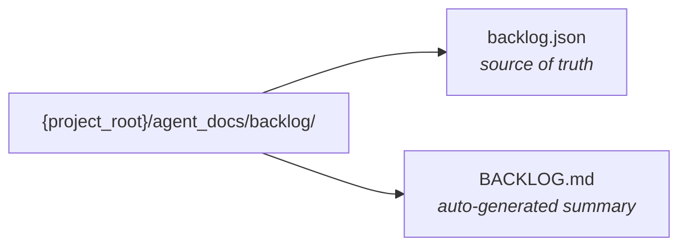

# Backlog Management System

Structured JSON-based backlog replacing the markdown template. All backlog data lives in `agent_docs/backlog/` relative to the project root.

## File Layout



## Script Resolution

The script `backlog_manager.py` is bundled with this skill. Resolve it **once per session** in this order (first match wins):

1. `~/.pi/agent/omni-sw.json` → `backlog_script` (written by the `pi-omni-sw` extension).
2. Glob `**/omni-sw-backlog/scripts/backlog_manager.py` (standalone install).

```bash
SCRIPT=""
if [ -f "$HOME/.pi/agent/omni-sw.json" ]; then
  SCRIPT=$(python -c "import json,os;print(json.load(open(os.path.expanduser('~/.pi/agent/omni-sw.json')))['backlog_script'])" 2>/dev/null)
fi
ls "$SCRIPT"
```

Store the result as `{SCRIPT}` for all subsequent commands.

## Permissions

Pass `--caller <agent>` on every command. The script rejects unauthorized operations. See `omni-sw-shared/agent-common.md` for the full permission matrix.

## Commands

For the full commands reference (init, create, edit, status, list, stats, get, delete, render, question), see [references/commands.md](references/commands.md).

## Mutation Response Format

`create` and `edit` return slim confirmations to minimize context usage:

- **create:** `{"success": true, "id": "US-001"}`
- **edit:** `{"success": true, "id": "US-001", "changes": ["title", "priority"]}`

Use `get --id <US-XXX>` to retrieve the full story if needed after mutation.

## Query Selection Guide

| Need | Command |
| ------ | --------- |
| Progress overview (counts only) | `stats` |
| Story list (IDs + titles + status) | `list --format summary` |
| Story list (specific fields) | `list --fields id,title,acceptance_criteria` |
| Story list (full detail minus audit) | `list --format json` |
| Single story (all fields + history) | `get --id US-XXX` |

## Status Transitions by Phase

| Phase     | Agent | Typical Transitions                          |
|-----------|-------|---------------------------------------------|
| Plan      | PO    | → Draft → Ready                             |
| Design    | TL    | Ready → In Design                           |
| Validate  | PM/TL | In Design → Validated                       |
| Specify   | QA    | Validated → Specified                       |
| Implement | Dev   | Specified → In Progress → In Review         |
| Review    | TL    | In Review (stays, or → In Progress if issues)|
| Test/Verify | QA  | In Review → In Testing → Done               |

## Migration from Legacy BACKLOG.md

For migration workflows, read [references/migration.md](references/migration.md). Only triggered by `/skill:omni-sw-po migrate` or `/skill:omni-sw-pm migrate`.

## Team Orchestration

For team-based workflows using subagents, see [references/team-orchestration.md](references/team-orchestration.md).

## JSON Schema

For the complete data structure, see [references/schema.md](references/schema.md).
