# Phase-Agent Matrix & Gate Conditions (TDD flow)

Quick reference for the orchestrator's phase routing, model assignments, and gates.

## Flow Overview

```
Plan → Design & Contracts → Validate → Specify (RED) → Implement (GREEN) → Review → Verify → Document
                                          └──── Implement ⇄ QA test-review handshake ────┘
```

Tests are authored **before** implementation: QA derives the suite from the acceptance criteria and from `CONTRACTS.md`, the RED gate proves it fails for the right reasons, and Dev implements until it is green.

## Phase → Agent Mapping

| # | Phase | Lead Agent | Model Config | Registered Agent | Skill Command | Assists | Output Artifacts |
| --- | ------- | ----------- | ----------- | ------------------ | --------------- | --------- | ------------------ |
| 1 | Plan | PM → PO | models.json | `omni-sw-pm`, `omni-sw-po` | `/skill:omni-sw-pm plan`, `/skill:omni-sw-po plan` | TL/Dev/QA | `{DOCS_PATH}/PROJECT_BRIEF.md`, backlog |
| 2 | Design & Contracts | TL | models.json | `omni-sw-tl` | `/skill:omni-sw-tl design` | Dev/QA | `{DOCS_PATH}/ARCHITECTURE.md`, `{DOCS_PATH}/CONTRACTS.md` |
| 3 | Validate | PM + TL | models.json | `omni-sw-pm`, `omni-sw-tl` | `/skill:omni-sw-pm validate`, `/skill:omni-sw-tl validate` | PO | `{DOCS_PATH}/VALIDATION.md` |
| 4 | Specify (RED) | QA | models.json | `omni-sw-qa` | `/skill:omni-sw-qa specify` | TL | `{DOCS_PATH}/TEST_SPEC.md`, failing tests in `tests/` |
| 5 | Implement (GREEN) | Dev | models.json | `omni-sw-dev` | `/skill:omni-sw-dev implement` | TL | Source code in `src/` + complementary tests |
| 6 | Review | TL | models.json | `omni-sw-tl` | `/skill:omni-sw-tl review` | QA | `{DOCS_PATH}/REVIEW.md` |
| 7 | Verify | QA | models.json | `omni-sw-qa` | `/skill:omni-sw-qa test` | TL | `{DOCS_PATH}/TEST_REPORT.md`, coverage |
| 8 | Document | PM + TL | models.json | `omni-sw-pm`, `omni-sw-tl` | `/skill:omni-sw-pm document`, `/skill:omni-sw-tl document` | PO/Dev/QA | `README.md`, `CHANGELOG.md`, `{DOCS_PATH}/API_REFERENCE.md` |

## Model Routing

Each agent's model comes from `"<phase>:<role>"` in `omni-sw-shared/models.json`. When the value is `null`/absent, **omit the `model` parameter** and the agent inherits the session/default model. Values are provider-agnostic pi model ids, optionally with a `:thinking` suffix.

`models.json` (editable): maps each agent by `"<phase>:<role>"` (e.g. `"design:tl": "openai/gpt-5.2:high"`, `"qa": ...` is NOT valid — keys are always `<phase>:<role>`) to a concrete `provider/model[:thinking]` id — any provider. The `:thinking` suffix sets pi's thinking level (`:off`..`:max`). `null` or absent key = inherit the session/default model, so the agency runs immediately on whatever default is configured. Provider-agnostic: no vendor or tier naming is assumed anywhere.

### Model Selection Principles

There are no abstract tiers. Model choice is per `"<phase>:<role>"` in `models.json`: leads that require heavy judgment (architecture, contracts, gate verdicts) typically get a stronger model than lightweight assists (notes, alignment checks), but any model from any provider can be assigned to any agent.

### Full Agent Matrix

`name` is the phase-scoped task label (used for `todo`); `agent` is the registered pi-subagents agent id passed to `subagent`.

| Phase | Name | Agent | Role |
| ------- | ------ | ------- | ------ | ------ |
| Plan | `pm-plan` | `omni-sw-pm` |  Lead: PROJECT_BRIEF.md |
| Plan | `po-plan` | `omni-sw-po` |  Lead: backlog from brief |
| Plan | `tl-plan-assist` | `omni-sw-tl` |  Assist: risk notes |
| Plan | `dev-plan-assist` | `omni-sw-dev` |  Assist: implementability notes |
| Plan | `qa-plan-assist` | `omni-sw-qa` |  Assist: testability notes |
| Design | `tl-design` | `omni-sw-tl` |  Lead: ARCHITECTURE.md + CONTRACTS.md |
| Design | `dev-design-assist` | `omni-sw-dev` |  Assist: implementability review |
| Design | `qa-design-assist` | `omni-sw-qa` |  Assist: contract/testability review |
| Validate | `pm-validate` | `omni-sw-pm` |  Lead: business validation |
| Validate | `tl-validate` | `omni-sw-tl` |  Lead: technical + contract validation |
| Validate | `po-validate-assist` | `omni-sw-po` |  Assist: backlog alignment |
| Specify | `qa-specify` | `omni-sw-qa` |  Lead: author failing business-rule suite (RED) |
| Specify | `tl-specify-assist` | `omni-sw-tl` |  Assist: contract coverage review |
| Implement | `dev-implement` | `omni-sw-dev` |  Lead: make the frozen suite green |
| Implement | `tl-implement-assist` | `omni-sw-tl` |  Assist: on-demand technical guidance |
| Review | `tl-review` | `omni-sw-tl` |  Lead: code review, REVIEW.md |
| Review | `qa-review-assist` | `omni-sw-qa` |  Assist: correctness review |
| Verify | `qa-test` | `omni-sw-qa` |  Lead: run frozen suite, coverage, TEST_REPORT.md |
| Verify | `tl-test-assist` | `omni-sw-tl` |  Assist: coverage review |
| Document | `pm-document` | `omni-sw-pm` |  Lead: README.md, CHANGELOG.md |
| Document | `tl-document` | `omni-sw-tl` |  Lead: API_REFERENCE.md, ARCHITECTURE.md |
| Document | `po-document-assist` | `omni-sw-po` |  Assist: documentation verification |
| Document | `dev-document-assist` | `omni-sw-dev` |  Assist: developer documentation |
| Document | `qa-document-assist` | `omni-sw-qa` |  Assist: test documentation |

**Summary:** 11 lead spawns, 13 assist spawns.

### Agent Naming Convention

Task label (todo): `{role}-{phase}` (lead) / `{role}-{phase}-assist` (assist).
Registered agent (spawn): `omni-sw-{role}`.

### Phase Lifecycle

1. Loop over the `waves` array returned by `phase prepare`.
2. Activate every agent in a wave in parallel, branching on `<agent.activation>`:
   - `spawn` → `subagent({ agent: <agent.agent>, task: <agent.prompt>, ...(agent.model ? { model: agent.model } : {}) })`
   - `resume` → `subagent({ action: "resume", id: <agent.resume_from_run_id>, message: <agent.prompt> })`
3. Persist the run id returned by that call: `state agent-session --key {phase}:{role} --run-id <run_id> --iteration <agent.iteration>`.
4. Adopt `<agent.name>` as the `todo` owner for that task.
5. Monitor via `todo`; handle `[QUESTIONS]` via `ask_user_question`.
6. Wait for wave N before spawning wave N+1.
7. Proceed to the next phase.

## Gate Conditions

### Validate (Dual Gate)

| PM Verdict | TL Verdict | Action |
| ----------- | ----------- | -------- |
| APPROVED | APPROVED | Proceed to **Specify (RED)** |
| REPROVED | any | Return to **Plan** |
| any | REPROVED | Return to **Design & Contracts** |

The technical verdict must also confirm `CONTRACTS.md` is complete enough for QA to author the whole suite.

### Specify (RED Gate)

| Verdict | Condition | Action |
| --------- | ----------- | -------- |
| `RED_PASS` | Every `Must` AC and every contract has a test; suite compiles; all tests fail for the right reason; no implementation yet | Proceed to **Implement (GREEN)** |
| `RED_FAIL_TESTS` | Missing tests, tests that pass, or infrastructure errors | Return to **Specify** (QA revises the suite) |
| `RED_FAIL_CONTRACT` | Contracts missing/ambiguous/untestable | Return to **Design & Contracts** |

### Review

| Outcome | Action |
|---------|--------|
| Blocking issues | Return to **Implement** |
| No blocking issues | Proceed to **Verify** |

### Verify

| Outcome | Action |
| --------- | -------- |
| Bug (code issue) | Return to **Implement**, then re-verify |
| Test issue | Return to **Specify** — QA owns the suite, so only QA revises it |
| All pass | Proceed to **Document** |

## Implement ⇄ QA Test-Review Handshake

During Implement, Dev works only until the frozen suite is green. If Dev believes a QA-authored test is wrong:

1. Dev sends `[TEST-REVIEW]` with the test id, the reason, and a proposed correction, then **stops and waits**.
2. The orchestrator relays the request to a QA agent. **Prefer resuming the recorded QA session** (the one that authored the suite, from `specify:qa` in the activation journal) over spawning a new one — it already knows why each test exists. Spawn a fresh `qa-test-review` only when no run id is recorded or the resume fails.
3. QA either fixes the test itself or rejects with an explanation.
4. The orchestrator relays the ruling back to Dev and resumes it.

Only QA may edit QA-authored tests. Dev may add distinctly named complementary tests but must never edit, delete, or weaken the frozen suite.

## Feedback Loop Limits

Maximum **3 iterations per gate** before escalating to the user with a full issue summary.

On gate failure: increment the loop counter, record the verdict, then **re-enter the target phase and continue the same sessions** — call `phase prepare` for the target phase and honor the returned `activation` (see *Loop-back Activation* in the orchestrator SKILL.md). Do NOT shut the phase agents down and do NOT spawn fresh agents: re-instantiating a role throws away its context and makes it re-read its role skill, `CLAUDE.md` and every artifact, which is the dominant cost of a loop.

Use `phase prepare --fresh` only when an unanchored verdict is genuinely required (loop stuck at the iteration limit, or the role is defending the artifact it produced). Resume preserves the session's model, so a loop-back must stay within the same phase — the model for a `{phase, role}` pair never changes, and cross-phase reuse is not automated.

## Sequential Dependencies Within Phases

- **Plan:** PM + TL/Dev/QA assists run in parallel; PO runs after PM completes.
- **Design:** TL produces ARCHITECTURE.md and CONTRACTS.md first; Dev/QA assists review after.
- **Validate:** PM and TL in parallel; PO after.
- **Specify:** QA authors the suite; TL reviews contract coverage after.
- **Implement:** Dev leads; TL is on-demand guidance.
- **Review:** TL first; QA after.
- **Verify:** QA first; TL coverage review after.
- **Document:** PM + TL in parallel; PO/Dev/QA after.

## Parallel Pipeline Mode

When the backlog has multiple independent feature areas, the orchestrator may parallelize Specify → Implement → Review → Verify per feature.

- Plan, Design & Contracts, and Validate always run **globally**.
- Document runs **globally** after all feature pipelines finish.
- Stories with cross-feature dependencies go to wave 2.

### Pipeline Agent Naming

| Phase | Feature | Task label | Registered agent |
| ------- | --------- | ----------- | ------------------ |
| Specify | auth | `qa-specify-auth` | `omni-sw-qa` |
| Implement | auth | `dev-implement-auth` | `omni-sw-dev` |
| Review | auth | `tl-review-auth` | `omni-sw-tl` |
| Verify | auth | `qa-test-auth` | `omni-sw-qa` |

Per-agent models follow the full matrix and `models.json`. The Implement ⇄ QA handshake applies per feature.

### Incremental Flow

```mermaid
gantt
    title Parallel Feature Pipelines (TDD)
    dateFormat X
    axisFormat %s

    section Feature A
    Specify   :a0, 0, 1
    Implement :a1, after a0, 3
    Review    :a2, after a1, 2
    Verify    :a3, after a2, 2

    section Feature B
    Specify   :b0, 0, 1
    Implement :b1, after b0, 2
    Review    :b2, after b1, 1
    Verify    :b3, after b2, 1

    section Global
    Document  :milestone, after a3 b3, 0
```


